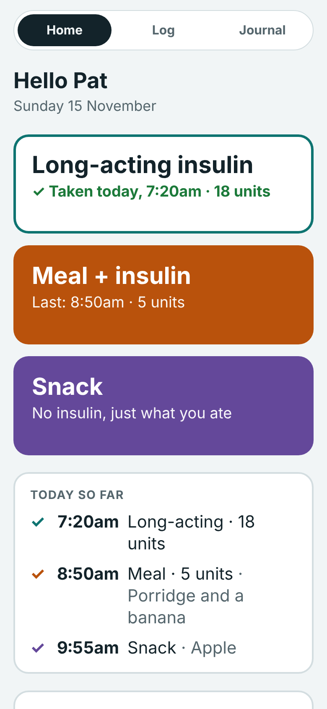
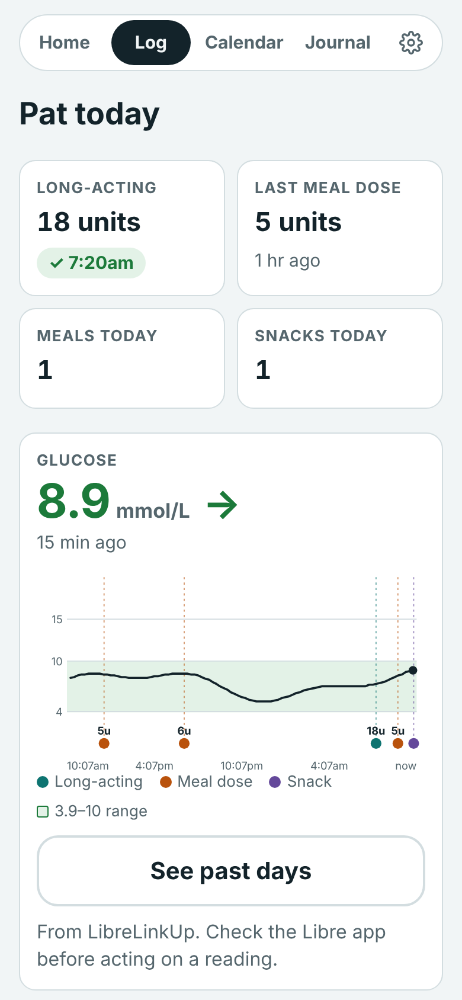
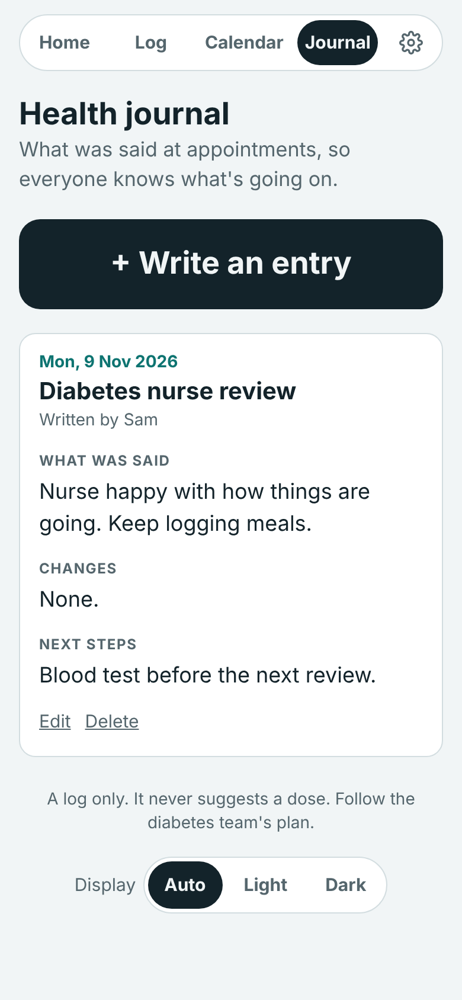
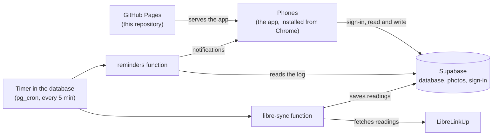

# Dose Log

A simple shared log of insulin doses and meals, kept by the person taking them and visible to their family. You host it yourself, so your data stays in your own account.

> **Not a medical device. It only records what the person says they took.** It never suggests, calculates or adjusts a dose, and it should stay that way: software that does those things can count as a medical device. Always follow your diabetes team's plan. Provided as is, with no warranty (see [LICENSE](LICENSE)).

<p align="center">
  
  
  
</p>
<p align="center"><sub>Screenshots use made-up data.</sub></p>

## What it does

- **Home:** three big buttons for the person taking the doses: long-acting insulin, meal + insulin, snack. Food can be logged as a photo, a few words, or carbs.
- **Log:** today's status for the family, a flag if long-acting hasn't been logged by a set time, and a timeline of every dose, meal and snack.
- **Calendar:** a shared month calendar of appointments. The Home screen shows the next one.
- **Journal:** after an appointment, whoever went writes what was said, any changes and next steps, so everyone stays up to date.
- **Safety:** tapping long-acting twice in a day shows a warning first.
- **Optional:** glucose readings from LibreLinkUp, and reminder notifications if a dose or meal hasn't been logged.

## How it works

- The app is plain HTML and JavaScript with no build step, hosted for free on GitHub Pages.
- Data, photos and sign-in live in your own [Supabase](https://supabase.com) project (free tier is plenty for a family).
- Sign-in is a code sent by email. Nobody sees anything unless their email is on the family list, and the database enforces that on every request, not just the app.
- This repository holds only code. No health data is ever stored in it.

### How the pieces fit



The core app is just GitHub Pages, the phones and Supabase. The timer, the two functions and LibreLinkUp are only needed for the optional glucose and reminders.

### Database files

Run these in Supabase → **SQL Editor**: open the file on GitHub, copy its contents, paste them into a new query and click **Run** (paste the SQL itself, not the file name). Every file is safe to run more than once.

| File | Needed? | What it adds |
| --- | --- | --- |
| `setup.sql` | Yes | Log, settings, family list, food photos |
| `02-appointments.sql` | Yes | Calendar |
| `05-journal.sql` | Yes | Journal |
| `08-home-phone-view.sql` | Yes | "Can look back at records" switch for the Home-screen phone |
| `09-admin-role.sql` | Yes | Admin role: only admins change settings and the family list |
| `10-block-signups.sql` | Yes, after you've added yourself | Only family-list emails can create an account |
| `13-integrity.sql` | Yes | "Logged by" can't be faked; limits for the Home-screen phone (see [Who can do what](#who-can-do-what)) |
| `03-glucose.sql`, `04-schedule.sql` | For glucose | Glucose tables, and the timer that runs `libre-sync` |
| `06-reminders.sql`, `07-schedule-reminders.sql` | For reminders | Reminder settings, and the timer that runs `reminders` |
| `11-dose-checks.sql` | Optional | Admins can mark doses as checked and get an alert for each new dose |
| `12-keep-glucose.sql` | Only when upgrading | Keeps glucose readings if an older copy of `libre-sync`, which deleted them after 90 days, is still deployed |

The numbers show the order the files were written, not the order to run them. Follow the steps below.

## Set up your own

You need a GitHub account, a Supabase account, and an email account that can send mail (Gmail with an app password is fine). Allow about an hour.

1. **Get a copy of this code.** Fork this repository, or use it as a template, into your own GitHub account.
2. **Create a Supabase project.** Pick a region close to you. When asked, leave "Automatically expose new tables" **off** and "Enable automatic RLS" **on**, so new tables are locked by default.
3. **Create the database.** In the SQL Editor (see [Database files](#database-files) for how), run these in order:
   `setup.sql`, `02-appointments.sql`, `05-journal.sql`, `08-home-phone-view.sql`, `09-admin-role.sql`, `13-integrity.sql`
4. **Add yourself as the first admin.** Still in the SQL Editor, run this with your own email and name:
   ```sql
   insert into public.members (email, name, role) values ('you@example.com', 'Your name', 'admin');
   ```
   Then run `10-block-signups.sql`. From then on only people on the family list can create an account, so add each person to the family list before they first sign in.
5. **Set up sign-in emails.** Supabase → **Authentication → Emails → Set up SMTP** (Gmail: `smtp.gmail.com`, port 587, an [app password](https://myaccount.google.com/apppasswords)). Supabase only lets you edit email templates once custom SMTP is on. Then, in both **Confirm sign up** and **Magic Link**, make the message body show the code:
   ```html
   <h2>Your Dose Log code</h2><p>Type this into Dose Log:</p><h1>{{ .Token }}</h1>
   ```
6. **Point the app at your project.** Your copy of `config.js` still holds the original author's project details. Open it on GitHub (pencil icon to edit) and replace them:
   - `supabaseUrl`: your project URL, e.g. `https://abcdefghijklmnop.supabase.co` (Supabase → **Project Settings → Data API**)
   - `supabaseKey`: your publishable key, starting `sb_publishable_` (Supabase → **Project Settings → API Keys**)
   - `vapidPublicKey`: set it to `""` for now. You only fill it in if you set up reminders.

   Commit the change. These values are meant to be public. Never put a secret key (`sb_secret_…` or `service_role`) anywhere in this repository. `config.example.js` is a blank copy for reference.
7. **Publish it.** GitHub → your repository → **Settings → Pages** → deploy from branch `main`, folder `/ (root)`. A minute later your site is at `https://<your-username>.github.io/<repository-name>/`. Put that address in Supabase → **Authentication → URL Configuration → Site URL**, so emailed sign-in links work too.
8. **Open it on each phone,** sign in, and add it to the home screen. Add everyone else under **Settings → Family list**. Give the phone of the person taking the doses the role **Logs doses**: it opens on the big buttons and can't change settings.

## Deploying an Edge Function

Both optional extras below run as Supabase Edge Functions. To deploy one:

1. Supabase → **Edge Functions** → **Deploy a new function** → **Via Editor**.
2. Name it exactly as the step says (`libre-sync` or `reminders`). The timer calls it by that name.
3. Replace the example code with the whole contents of the matching `supabase/functions/<name>/index.ts` file, then click **Deploy function**.
4. On the function's page, turn **off** the JWT verification setting and save. The timer doesn't sign in as a user; the function checks `SYNC_SECRET` instead.

With the [Supabase CLI](https://supabase.com/docs/guides/cli) it's one command per function, e.g. `supabase functions deploy reminders --no-verify-jwt`.

Secrets go in Supabase → **Edge Functions → Secrets**. For `SYNC_SECRET`, make a long random string: run `openssl rand -hex 32` in a terminal, or have a password manager generate 40 or more random characters. Keep a copy, because you paste the same value into the schedule SQL files.

## Optional: glucose from LibreLinkUp

LibreLinkUp has no official API. This uses the same requests as the LibreLinkUp app, so it can break if Abbott changes them. If it does, the app shows the error and everything else keeps working. Glucose is shown in mmol/L.

1. Make a separate LibreLinkUp account for this (not anyone's personal one), sign in to the LibreLinkUp app with it once and accept the terms. In the Libre app, invite it and accept the invite.
2. SQL Editor → run `supabase/03-glucose.sql`.
3. Deploy `supabase/functions/libre-sync/index.ts` as `libre-sync` (see [Deploying an Edge Function](#deploying-an-edge-function)).
4. Edge Functions → Secrets: `LIBRE_EMAIL` and `LIBRE_PASSWORD` (the account from step 1), and `SYNC_SECRET`.
5. SQL Editor → run `supabase/04-schedule.sql` with `PASTE_YOUR_PROJECT_REF` replaced by your project ref (the part before `.supabase.co` in your project URL) and `PASTE_SYNC_SECRET` by the same random string. Don't commit the real values.

## Optional: reminder notifications

Sent only to phones whose family-list role is "Logs doses", and only when nothing has been logged yet (breakfast, lunch, evening meal: no meal + insulin entry since the previous reminder time; long-acting: none today). Times are set in Settings and are UK time.

1. SQL Editor → run `supabase/06-reminders.sql`.
2. Generate a key pair with `npx web-push generate-vapid-keys`, and put the public half in `config.js` as `vapidPublicKey`.
3. Deploy `supabase/functions/reminders/index.ts` as `reminders` (see [Deploying an Edge Function](#deploying-an-edge-function)).
4. Edge Functions → Secrets: `VAPID_PUBLIC_KEY` (same as `vapidPublicKey`), `VAPID_PRIVATE_KEY`, `VAPID_SUBJECT` (a `mailto:` address of yours, e.g. `mailto:you@example.com`) and `SYNC_SECRET` (the same value as for glucose, if you set that up).
5. SQL Editor → run `supabase/07-schedule-reminders.sql` with `PASTE_YOUR_PROJECT_REF` and `PASTE_SYNC_SECRET` replaced, as above.
6. On the dose-logging phone, open the app installed from Chrome and tap **Turn on reminders**.

### Journal notifications

Run `supabase/14-journal-alerts.sql` and redeploy the `reminders` function. Whenever someone adds or edits a journal entry, everyone else on the family list whose phone has notifications on (Settings → Notifications, or Turn on reminders on the Home-screen phone) gets a notification with the gist of it, within 5 minutes. The person who made the change isn't notified.

### Glucose history

Readings are kept indefinitely. From the glucose card on the Log screen, **See past days** opens any day's graph with its doses and meals, a daily summary (average, share of readings in the 3.9–10 range, lows and highs), the last two weeks at a glance, and buttons to download everything as CSV files. Download a copy now and then: free Supabase projects don't come with backups you can download.

### Dose checks and alerts for admins

Run `supabase/11-dose-checks.sql`. Admins then get a **Seen and agree** button on each dose in the Log; everyone sees who checked it, and only admins can mark it (the database enforces this). If the reminders function is set up, admins can also tap **Get dose alerts on this phone** in Settings to be notified whenever a new dose is logged on the Home-screen phone. Family members and the Home-screen phone never get these alerts.

## Who can do what

The database enforces all of this, not just the app (`09-admin-role.sql` and `13-integrity.sql`):

- **Admin:** everything, including Settings, the family list and marking doses as checked.
- **Family:** log, edit and remove entries; add and edit appointments and journal entries.
- **Logs doses** (the Home-screen phone): log doses, meals and snacks, and change or remove only the ones it logged; write journal entries, and edit or delete only its own; read appointments. It can look back at the log, calendar and journal unless an admin turns that off in Settings.
- "Logged by", "Written by" and "Created by" are always set by the database from the signed-in email, and a new dose can't arrive already marked as checked.

## Privacy and safety notes

- This is health information. You are responsible for the Supabase project you create: use a strong password, turn on two-factor sign-in for your Supabase and GitHub accounts, and only add people who should see it.
- Photos are stored in a private bucket and shown through short-lived links. A photo taken for a log that is then abandoned is deleted.
- The Supabase library is kept in this repository (`js/vendor/`, copied unchanged from the npm package) rather than loaded from a CDN, so no outside server can change the code that handles your sign-in and data.
- With `10-block-signups.sql` run, an email that isn't on the family list can't create an account or get a code, so add people to the family list before they first sign in. Without it, anyone who finds your site can have a code emailed to them (they still see nothing, but they use up your sending allowance).
- This is built for one household per install. Running it as a service for other people's health data is a different matter (in the UK, for example, that brings UK GDPR obligations) and is not what this repository sets up.

## Troubleshooting

- **"Dose Log isn't connected to its database yet"**: `config.js` still has placeholders. See step 6.
- **"That email isn't on the family list"**: an admin adds the email in **Settings → Family list** first, then the person signs in.
- **No sign-in email arrives**: check the spam folder, then the SMTP details in step 5. Supabase → **Logs → Auth** shows why a send failed.
- **The glucose card shows an error**: the message comes straight from `libre-sync`. The most common fix is opening the LibreLinkUp app with the follower account and accepting new terms. More detail: Supabase → **Edge Functions → libre-sync → Logs**.
- **No reminders**: on the Home-screen phone, the app must be installed from Chrome, with **Turn on reminders** tapped and notifications allowed. To send one straight away, open Supabase → **Edge Functions → reminders → Test**, set the method to POST, add the header `x-sync-secret` with your `SYNC_SECRET`, and send the body `{"force": "breakfast"}`.
- **Did the timer run?** In the SQL Editor:
  ```sql
  select jobname, status, start_time, return_message
  from cron.job_run_details join cron.job using (jobid)
  order by start_time desc limit 10;
  ```

## Updating your copy

1. On your copy's GitHub page, click **Sync fork**. If it reports a conflict in `config.js`, keep your own version.
2. Look at what changed in `supabase/`. Run any new or changed SQL file (they're all safe to re-run), and redeploy any function whose `index.ts` changed.

## Limitations

- Built around insulin, UK conventions (mmol/L, `en-GB` dates, UK-time reminders) and one household.
- Needs a connection: there is no offline mode.
- The glucose feed can stop without warning if Abbott changes LibreLinkUp. Always treat the sensor's own app as the source of truth.
- Reminders need a phone and browser that support web push notifications. The app is built for Chrome on Android, installed to the home screen.

## Code map

There is no build step: the browser loads the files in `js/` directly as ES modules.

| File | What it does |
| --- | --- |
| `index.html`, `style.css`, `manifest.webmanifest`, `sw.js` | The page, styles, install-to-home-screen details, and the service worker that shows reminders |
| `config.js` | Your Supabase URL and publishable key (see `config.example.js`) |
| `js/main.js` | Start-up |
| `js/client.js` | Creates the Supabase client from `config.js` |
| `js/state.js`, `js/selectors.js` | The shared state object, and read-only questions about it |
| `js/render.js` | Chooses and draws the current screen |
| `js/views/` | One file per screen (home, log, glucose, calendar, journal, settings, login) |
| `js/data.js` | Loads data from Supabase and listens for realtime updates |
| `js/auth.js` | Email-code sign-in |
| `js/actions/` | Everything that changes data: logging, appointments, journal, settings |
| `js/events.js` | Click, submit and change handling |
| `js/push.js` | Reminder notification subscription |
| `js/vendor/` | `@supabase/supabase-js` 2.45.4, from the npm package's `dist/umd` folder (MIT licence alongside) |
| `supabase/` | Database setup SQL (see [Database files](#database-files)) and the optional Edge Functions |
| `docs/screenshots/` | The pictures at the top of this file |

To try changes locally, run `python3 -m http.server` in this folder and open `http://localhost:8000`.

Two names date from the first version and are kept so existing installs keep working: the role stored as `dad` (shown in the app as "Logs doses"), and the `dad_sees_records` setting. Page addresses `#dad` and `#family` still work as `#home` and `#log`.

## Licence

[MIT](LICENSE).
